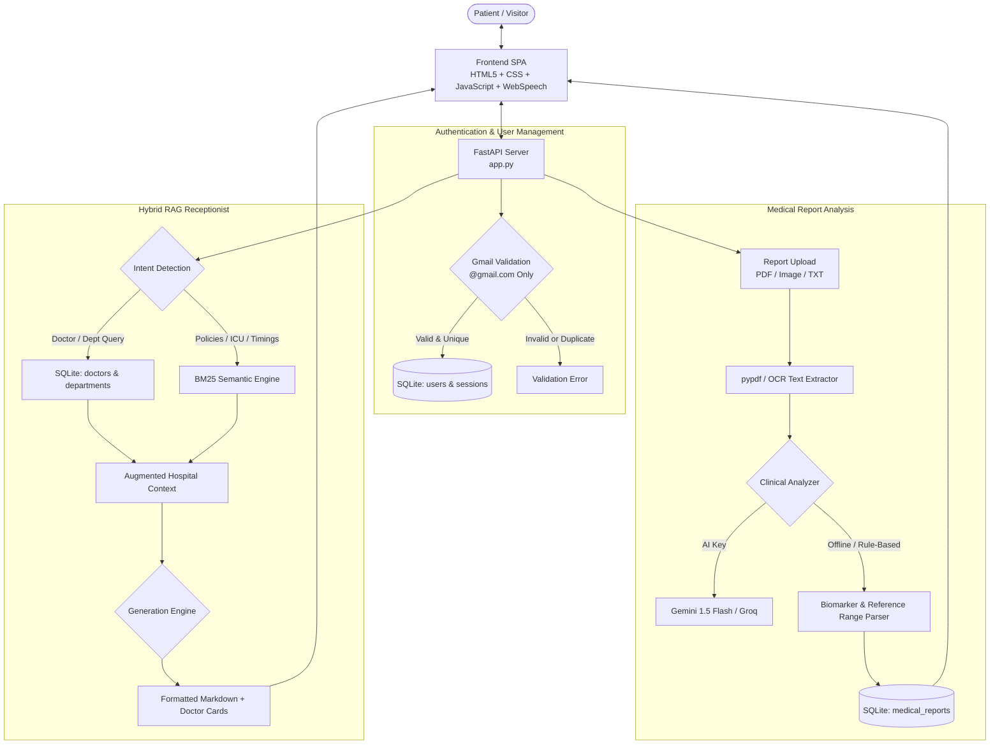

# 🏥 CareWell Hospital AI Receptionist & Clinical Portal (Full-Stack RAG System)

An intelligent, full-stack Healthcare Virtual Receptionist, Patient Care Coordinator, and **Medical Lab Report AI Analyzer** built with **Python FastAPI**, **SQLite**, **Hybrid RAG**, **Gmail-Only Authentication**, and a **Modern Responsive Frontend**. 

> **College Project Submission Ready**: Single-deployment architecture designed to be hosted **100% free** on **Render** or **Vercel** with **$0 cost** and zero external database setup.

---

## 🌟 Key Features

1. **Intelligent Hospital Receptionist ("Aura")**:
   - Accurately answers questions like:
     - *"Who and all doctor working for general physician?"* ➔ Returns all General Physicians with qualifications, visiting days, timings, fees, and room numbers.
     - *"What are the timings for ICU visiting patients?"* ➔ Returns explicit morning (11 AM - 1 PM) and evening (5 PM - 7 PM) slots with ICU sanitation and visitor pass rules.
     - *"What are the general ward visiting hours?"* ➔ Explains ward timings (4 PM - 7 PM) and 24/7 attendant pass policies.
     - *"What is the emergency helpline and ambulance contact?"* ➔ Instant alert with direct dial to Level-1 Trauma Desk (+91-98765-43210).
2. **🔒 Gmail-Only Patient Authentication**:
   - **Domain Rule**: Login and registration are strictly restricted to `@gmail.com` addresses (no phone numbers or arbitrary usernames).
   - **Duplicate Prevention**: Existing registered accounts cannot register again; validated with clear user alerts.
   - **Secure Storage**: Passwords securely hashed with SHA256 + unique salts in SQLite `users` table.
   - **Session Management**: Session tokens stored in `user_sessions` and persisted in `localStorage`.
3. **📄 Medical Report Upload & Detailed AI Analysis**:
   - Upload lab reports in **PDF, PNG, JPG, JPEG, or TXT** formats.
   - **Automated Parameter Extraction**: Identifies key biomarkers (Hemoglobin, Fasting Blood Glucose, HbA1c, Total Cholesterol, HDL, LDL, Serum Creatinine, Bilirubin, TSH, etc.).
   - **Clinical Reference Range Comparison**: Evaluates values against adult laboratory reference intervals with `🟢 Normal`, `🔴 Elevated (High)`, and `🟡 Low` status badges.
   - **Plain-Language Interpretation**: Explains what the findings mean in patient-friendly terms without overwhelming medical jargon.
   - **Doctor Consultation Guidance**: Suggests targeted questions to ask their consulting physician.
   - **Report History**: Logged-in patients can view their previous reports anytime under **"My Reports"**.
4. **Hybrid RAG Architecture (Structured SQL + Semantic BM25)**:
   - Combines SQLite relational queries (for doctors and fees) with BM25 vector knowledge retrieval (for hospital policies, visiting hours, and cashless insurance).
5. **Multi-Model & Zero-Failure Dual Mode**:
   - **AI Mode**: Integrates with **Google Gemini (Free Tier)**, **Groq (Free Tier)**, or OpenAI.
   - **Built-in Smart Offline Synthesizer**: If no API key is provided, the chatbot and report analyzer run completely offline with zero rate limits, ensuring 100% reliability during college viva, grading, or demos!
6. **Interactive Healthcare UI**:
   - Medical portal theme (Teal/Emerald/Sky palette).
   - Clickable **Quick Suggestion Chips** for one-tap answers.
   - **Interactive Doctor Cards** with direct OPD appointment booking.
   - **Voice Input (Speech-to-Text)** via browser Web Speech API.
   - **Voice Output (Text-to-Speech)** with "Listen" button for audio receptionist responses.
   - **Emergency Modal** with one-tap dial buttons for Ambulance, Triage, and Blood Bank.
7. **Self-Contained Single Deployment**:
   - Frontend and backend live in one single codebase and deploy to one single URL on Render / Vercel with zero CORS issues.

---

## 🏗️ System Architecture



---

## 🗄️ Database Schema (`hospital.db`)

1. **`users`**: `id`, `email` (UNIQUE, `@gmail.com` enforced), `password_hash`, `salt`, `full_name`, `created_at`
2. **`user_sessions`**: `token` (PRIMARY KEY), `user_id`, `email`, `created_at`
3. **`medical_reports`**: `id`, `user_id`, `user_email`, `filename`, `file_type`, `extracted_text`, `analysis_result`, `created_at`
4. **`departments`**: `id`, `name`, `code`, `floor_location`, `phone_extension`, `description`, `head_of_department`
5. **`doctors`**: `id`, `name`, `department_id`, `specialization`, `qualification`, `experience_years`, `visiting_days`, `timings`, `consultation_fee`, `room_no`, `is_available`
6. **`hospital_knowledge`**: `id`, `category`, `title`, `content`, `keywords` (Contains ICU visiting rules, ward timings, ambulance, pharmacy, cashless insurance, etc.)
7. **`appointments`**: `id`, `patient_name`, `patient_phone`, `doctor_id`, `doctor_name`, `department_name`, `appointment_date`, `appointment_time`, `reason`, `status`, `created_at`
8. **`chat_logs`**: `id`, `session_id`, `sender`, `message`, `created_at`

---

## 🚀 Running Locally

### Step 1: Install Dependencies
```bash
pip install -r requirements.txt
```

### Step 2: Start the Web Server
```bash
python app.py
```
Open **`http://127.0.0.1:5000`** in your browser!

---

## ☁️ 100% Free Single Deployment Guide (Render)

1. Push code to GitHub:
   ```bash
   git init
   git add .
   git commit -m "Hospital AI Chatbot with Gmail Auth & Report Analysis"
   git push -u origin main
   ```
2. In [render.com](https://render.com), click **"New +"** ➔ **"Web Service"**.
3. Select your repository:
   - **Environment**: `Python 3`
   - **Build Command**: `pip install -r requirements.txt`
   - **Start Command**: `uvicorn app:app --host 0.0.0.0 --port $PORT`
   - **Plan**: **Free** ($0)
4. Click **"Deploy Web Service"**.

---

## 🎓 College Viva Q&A

**Q1: How does the login validation enforce Gmail-only and prevent duplicate accounts?**  
*Answer:* The authentication service sanitizes the email and runs a strict check ensuring it ends with `@gmail.com`. During registration, the database executes an indexed query `SELECT id FROM users WHERE email = ?`. If a match is found, an HTTP 400 error is returned with the message `"This Gmail address is already registered. Please login instead."`

**Q2: How does the Medical Report Analyzer work?**  
*Answer:* When a PDF, image, or text file is uploaded, the backend extracts text using `pypdf` or prepares imagery. It then scans clinical biomarkers (e.g., Blood Glucose, HbA1c, Cholesterol, Creatinine) and compares each tested value against standard laboratory reference ranges. It flags each as Normal, Elevated, or Low, explains the results in plain English, and stores the analysis in the SQLite `medical_reports` table linked to the user's Gmail ID.

**Q3: Why is single deployment beneficial for college submissions?**  
*Answer:* In a single deployment, FastAPI serves static assets (HTML/CSS/JS) and API endpoints simultaneously from one server. This eliminates Cross-Origin Resource Sharing (CORS) errors, prevents running two separate web services, and fits entirely within Render's free tier ($0/month).
